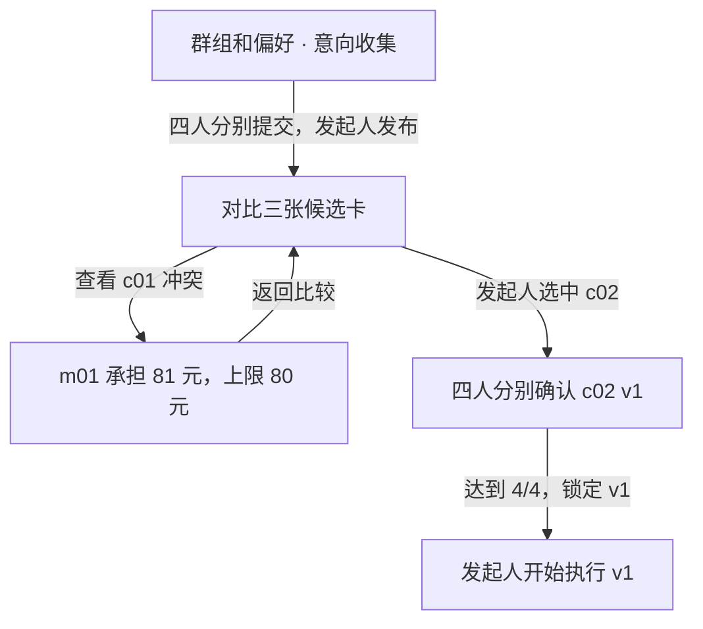
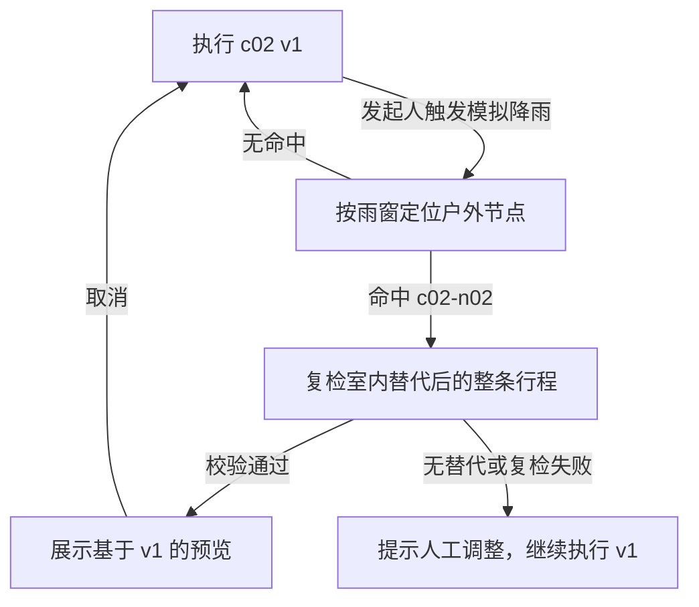
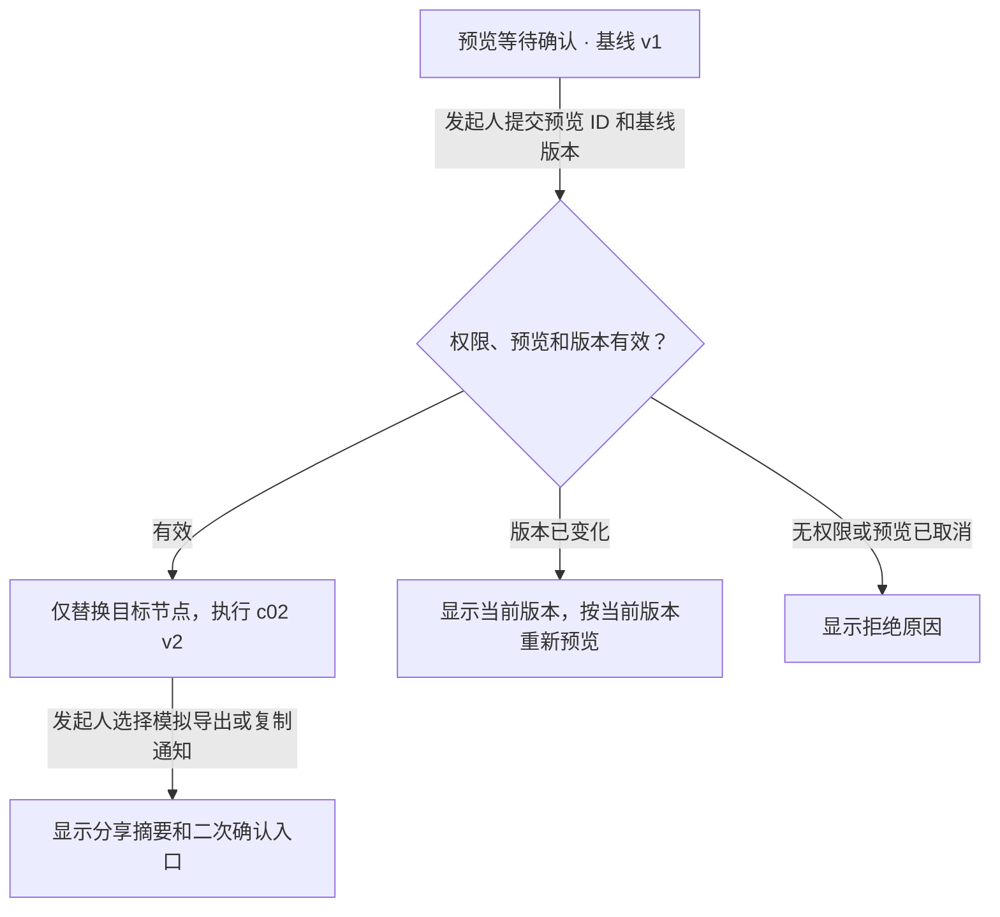

# 《同行计划》第一周演示流程

依据 A 成员修订版第一周任务书，以及其中引用的《同行计划-1(1).pdf》（项目执行版 2026-11-14）第 2 页第二、三节的状态、变更影响和用户授权要求、第 3 页第六节的四类交互。行程、金额、交通与天气来自[共享合成样例](../fixtures/demo-trip.json)。页面标记模拟，时间按北京时间显示。

| 验收路径 | 观察动作 |
| --- | --- |
| 第一周 Android 离线 | 在一台 Android 真机干净安装 C 的调试 APK，断网冷启动，依次切换 `m01`–`m04`，走完群组、偏好、候选、变更四页。现场查看冲突，先取消降雨变更，再重新预览并确认。以实际真机记录签收。 |
| 第一周 Python 核心 | 在仓库根目录运行 `python -m scripts.demo_trip_flow`，查看 B 的候选判定、成员确认、变更前后版本及节点。异常门槛由 `python -m unittest discover -s tests -p "test_trip_flow.py"` 复验。 |
| 第二周四机联机 | 四台 Android 手机各用独立服务端成员身份，通过同一邀请码入房，各自提交并读取共享快照，四端都显示同一份汇总及 4/4 进度。候选确认与变更继续按接口契约推进。 |

## 固定场景

11 月 21 日周六，四人从兰州大学城关校区出发，半日游后返回。四人共同可用时间为 13:30–17:00，均可接受地铁和步行。个人预算上限依 `m01` 至 `m04` 为 ¥80、¥90、¥100、¥120，均含往返交通。

| 候选 | 出发至返校 | 逐人承担额（按 `m01`–`m04`） | 硬约束结果 |
| --- | --- | --- | --- |
| `c01` 摄影体验 | 13:30–16:45 | ¥81 / ¥75 / ¥75 / ¥75 | `infeasible`。`m01` 超预算 ¥1（`R-BUD-01`）。 |
| `c02` 广场与展览 | 13:30–17:00 | ¥64 / ¥64 / ¥64 / ¥64 | `feasible`。户外拍照加室内展览，演示选中。 |
| `c03` 室内手作 | 13:45–16:45 | ¥72 / ¥72 / ¥72 / ¥72 | `feasible`。全室内活动，供比较。 |

## 正常确认

| 状态与动作 | 操作者与输入 | 输出和失败提示 |
| --- | --- | --- |
| `collecting` → `candidates`，提交偏好并发布 | 四人各自提交可用时间、预算、交通和偏好。发起人 `m01` 发布候选。 | 资料不足时显示待提交成员。资料已交但检测发现缺项或格式问题时，候选标记 `incomplete` 并指出字段，发起人可返回填报。 |
| `candidates` → `confirming`，查看冲突并选中候选 | 所有成员可查看 B 的逐候选判定。发起人选择 `c02`。 | `c01` 展示实际承担 8100 分、上限 8000 分及冲突成员，选择入口禁用。只有 `feasible` 可选择。选中后显示 `c02/v1`。无可行候选时引导返回填报。 |
| `confirming` → `executing`，确认并开始 | 四人分别确认 `c02/v1`，发起人在 4/4 后点击开始。 | 同版本重复确认只记一次。改选生成新版本并重新收集确认。缺确认时指出待确认成员，过期确认提示刷新当前候选和版本。 |

## 降雨预览

发起人选择「模拟降雨」。事件 `rain-01` 的模拟来源时间为 13:45，雨窗为 14:00–15:00。只有显式户外活动与雨窗有正时长重叠才命中。替代安排在同一活动区、同一时段。B 对替代后的总时段、交通、地点禁忌及逐人承担额重新检查。

| 基线节点 | 时间 | 预览结果 |
| --- | --- | --- |
| `c02-n01` 校园至活动区 | 13:30–14:00 | 保留。地铁段在雨窗开始时结束。 |
| `c02-n02` 户外广场 | 14:00–15:00 | 唯一受影响节点。拟换为室内摄影展厅 `c02-n02-r1`，每人费用仍为 ¥64。 |
| `c02-n03` 室内展览 | 15:00–16:30 | 保留。 |
| `c02-n04` 活动区至校园 | 16:30–17:00 | 保留。 |

`executing` 时由发起人提交当前计划版本及模拟降雨输入。可行时进入 `change_pending`，显示命中理由、替代前后对照、保留节点及基线版本。此时已确认行程仍为 `v1`。无命中时提示继续原行程；缺替代或复检失败时提示缺项或违规原因及人工调整入口。取消后继续执行 `v1`。

## 确认后更新

`change_pending` 时，发起人 `m01` 按离线演示权限确认当前预览。系统切回 `executing`，展示 `c02/v1 → c02/v2`、替换节点、保留节点、确认人及时间。四次候选确认的历史记录归属 `v1`，`v2` 展示发起人的变更批准。候选 ID 仍为 `c02`。导出或通知使用模拟操作，任何外部写入需二次确认。支付、预订、取消由用户操作。

## 需求证据与观察动作

优先级按第一周验收主线暂定为 P0。以下待验证主题来自任务书与合成样例，问卷证据编号待 D 汇总并去重后补入 [MVP 记录](mvp.md)。

| 需求编号与待验证主题 | 问卷证据编号 | 观察动作 |
| --- | --- | --- |
| MVP-01、MVP-02，成员单独填报与硬约束协商 | 待 D 核对事件并补录 | 切换四个身份检查独立回显，找出 `c01` 的冲突成员与金额，选择可行的 `c02`。 |
| MVP-03，同一份行程的成员确认 | 待 D 核对事件并补录 | Android 单机达到 4/4 后开启行程，用 Python 复验缺确认或旧版本。 |
| MVP-04，天气突变后的局部调整 | 待 D 核对事件并补录 | 从 Android 页面和 Python 输出都能指出一个替换节点、三个保留节点，并核对取消和确认分别对应的版本。 |
| MVP-05，授权后分享 | 待 D 核对事件并补录 | 在 Android 查看待分享内容和二次确认入口，取消后回到已确认行程。 |
